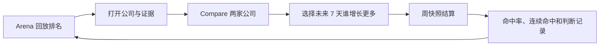

# Momentum Arena｜官网与商业化 PRD

> 工作名：Momentum Arena  
> 产品状态：概念阶段，当前仓库没有对应实现。本文定义目标产品与启动条件。

## 一句话需求

用融资、产品发布、人才、开源与客户证据建立 AI 初创公司的公开势头排名，让用户看到谁正在加速、为什么加速，并通过对比和每周 Pick 记录自己的判断。

## 背景与目标

AI 公司的重要变化分散在公司公告、代码库、媒体、招聘页和客户披露中。现有数据库擅长查公司资料，但用户仍需自己判断“最近发生了什么”和“这件事改变了什么”。

产品将“公开势头”定义为指定时间内能被统一规则观察的公开变化。它不代表公司的真实经营质量、私下进展或投资价值。首版不追求独家数据，但要保证公司覆盖、来源审核和计分规则一致。

目标：

- 用户进入 Arena 后 30 秒内能回答“最近谁在加速，为什么”。
- 每个影响分数的事件都能查看原始来源、审核结果、分数影响和修正记录。
- 排名、回放、公司证据、对比和 Pick 形成一条可重复使用的路径。
- 用人工交付验证招聘、专题赞助和机构 Arena 三个 2B 方向，在成交前不开发完整商业后台。

## 范围与阶段

| 阶段 | 交付内容 | 结束条件 |
|---|---|---|
| 数据运营试验 | 人工维护约 50 家公司；Seed、Series A、B、C、Growth 各约 10 家 | 形成 Evidence Review Skill v0，并算出 150 家覆盖的人力与成本 |
| 公开首版 | Arena、Company、Compare 三个页面；英文优先、全球覆盖、桌面优先并支持移动端 | 通过公开产品需求验证 |
| 14 天付费验证 | 招聘、专题赞助、机构 Arena 各用一个固定报价和交付物进行人工销售 | 任一方向通过商业验证标准 |
| 商业产品 | 只为已通过验证的方向开发企业后台和工作流 | 按该业务的续费、贡献毛利和交付时间继续评估 |

公开首版不包括：完整公司数据库、私有财务数据、付费排名、投票排名、现金预测、可购买或交易的积分、评论区、私信网络、原生 App、公开 API、自助广告系统、Founder 对标后台和三个商业后台。

机器人、硬件和芯片公司暂不参与公开排名，因为它们的产品与融资周期需要另一套可比规则。

## 产品结构

公开产品只有三个页面：

1. **Arena**：查看当前排名，并回放公司如何因公开事件上升或下降。
2. **Company**：查看一家公司的五维分数、Momentum Trail、证据、修正和公司回应。
3. **Compare**：对比两家公司的公开势头，并完成每周 Pick。

一级导航仅保留 Arena、Compare、搜索和账户入口。Company 通过排名、搜索和分享链接进入。Methodology、Why it moved、证据详情和纠错记录在当前页面用抽屉展示。

## 核心用户场景

| Case | 用户目标 | 操作 | 产品结果 |
|---|---|---|---|
| UC1 | 快速找到近期加速的公司 | 进入 Arena，选择融资阶段，可选赛道筛选 | 显示该阶段的 30 天正式排名及最近变化 |
| UC2 | 理解一次名次变化 | 回放排名或点击名次变化 | 显示公司自身分数变化、同组相对变化及对应证据 |
| UC3 | 核查公司信号 | 打开 Company 和证据抽屉 | 查看事件、来源、确认强度、利益关系与修正记录 |
| UC4 | 比较两家公司 | 在 Compare 选择两家公司 | 同轮次显示综合分和领先项；跨轮次只显示原始信号 |
| UC5 | 记录自己的判断 | 在同轮次 Compare 中选择未来 7 天势头增长更多的一方 | 保存 Pick，在下一周快照结算并更新个人记录 |
| UC6 | 回应平台记录 | 已验证公司管理员在具体事件下提交 Company Context | 审核后显示带身份、来源和编辑历史的公司回应 |
| UC7 | 订阅后续变化 | 关注公司或阶段，完成邮箱验证 | 收到每周变化邮件，链接还原对应状态 |

## Arena

Arena 以一张可回放的排行榜为主体。首页不另建 Top Movers、新闻 Feed 和 Replay 三套内容。

### 排名与筛选

正式排名只按融资阶段划分五个联赛：

- Seed，包括 Pre-seed
- Series A
- Series B
- Series C
- Growth，包括 Series D 及以后

滚动 30 天是唯一正式排名周期。时间控件的其他两种状态为：

- `7D Pulse`：高亮最近 7 天的事件与短期变化，名次仍引用当前 30 天正式排名。
- `90D Trail`：展示 90 天轨迹和历史节点，不产生另一套正式名次。

赛道使用以下标签：Foundation Models、AI Infrastructure & Data、Developer Tools、Horizontal Applications、Vertical AI & Agents。选择赛道后只隐藏不匹配的公司，保留原始联赛名次，不在筛选结果内重新计分或排序。

每个联赛至少有 5 家符合条件的公司，且最近 30 天至少有 3 家存在影响分数的事件，才显示数字名次并允许 Pick。未达到门槛时只显示原始信号和“样本不足”。

### 回放与事件表达

初始状态显示最新有效快照。用户播放后，排名行按真实历史快照移动，并在每次超越时展示对应事件。只要没有真实快照变化，页面就保持静止。

排名变化的主表达格式为：

> Sierra 从第 7 升至第 4。自身分数 +8.2，其中产品发布 +4.6、客户证据 +3.6；同期第 5 名公司的旧事件衰减亦改变了相对名次。

回放默认展示当时用户实际看到的版本。修正改变历史结果时，用户可切换到已修正版本，两者均保留明确标识。

赞助位位于排行榜外，始终显示 `Sponsor`。Sponsor 不能选择回放中出现的公司、事件顺序或排名结果。

### 数据状态

- 排名有效：显示最新快照和更新时间。
- 来源检查失败或审核未完成：继续显示上一个有效快照，同时显示“数据不完整”和影响范围；不发布受影响的新排名。
- 没有观察到新信号：可正常发布快照，对应维度显示“当前窗口未观察到公开信号”。

## Company

Company 页面包含：

- 当前联赛、当前名次、分数、更新时间与数据状态
- 7/30/90 天 Momentum Trail
- 融资、产品、人才、开源与开发者、客户证据五项分数
- `Why it moved`、事件时间线、原始来源与修正记录
- Compare、Pick、关注和分享入口
- 已验证公司提交的 Company Context

Company 使用可分享 URL。普通 Company 链接跟随最新有效快照；历史排名、Replay 节点和修正链接固定到具体版本。内容被撤回后，固定链接保留撤回说明。

### Why it moved

名次变化分为两层解释：

1. **公司自身分数变化**：新事件、旧事件衰减、证据修正、融资阶段变化或评分规则版本变化。
2. **同组相对名次变化**：其他公司的分数变化和同组归一化结果。

每个原因显示对应分数差、事件或规则版本。编辑说明只用于帮助理解，不取代可追溯原因。

### 证据表达

不使用单一 `Verified` 等级。每个事件分别显示三项信息：

| 维度 | 可选值 | 用户看到的含义 |
|---|---|---|
| 来源类型 | Company、Customer、Regulatory、Repository、Media、Investor | 谁发布或承载了这项信息 |
| 确认强度 | Directly Observed、Corroborated、Single-source、Estimated | 平台能够直接观察、多方交叉确认、仅有单一来源或属于估算 |
| 利益关系 | 未发现直接关系、当事方、投资关系、商业合作 | 来源与被评公司或平台是否存在直接利益关系 |

Directly Observed、Corroborated 和符合来源政策的 Single-source 事件可以影响分数。Estimated 只展示，对分数影响始终为 0。利益关系需要公开显示，不自动改变确认强度；商业合作方提交的事件按相同规则审核。

每个影响分数的事件必须包含发生时间、信号类型、原始来源、分数影响、收录时间和当前状态。

### 修正与 Company Context

公司和用户可以免费提交新来源或纠错。平台在 1 个工作日内确认收到，目标在 3 个工作日内给出结论。修正以新记录替换或撤回原结论，原记录、修正理由和受影响的排名版本仍可追溯。

已验证公司管理员可以针对具体事件提交 Company Context。回应需要标注作者身份、引用来源和编辑历史，审核后展示在平台证据旁。Company Context 不直接修改事件、确认强度、分数或名次；其中的新证据需走普通证据审核。

## Momentum Score

首版使用五个等权维度：

1. 融资速度：融资金额、轮次和距上轮融资时间。
2. 产品发布：重要产品上线、版本和能力更新。
3. 人才势头：公开招聘变化和关键人员加入。
4. 开源与开发者：GitHub、Hugging Face、SDK 等公开增长。
5. 客户证据：公开客户、使用量、收入或合同证据。

每项占 20%。有效事件先按评分规则 v1 计算原始分，再在公司当前融资阶段的联赛中归一化为 0–100。Momentum Score 是五项归一化分数的等权结果。

当前 30 天未观察到有效信号时，该维度按 0 分计入，且不把权重分给其他维度。来源失败或审核未完成时，按 Arena 的“数据不完整”状态处理，不将未知值计为 0。

计分遵守以下去重规则：

- 同一底层事实只能形成一个计分事件；多篇公告或报道只增加交叉确认。
- 同一公司在短时间内的同维度多个事件使用递减贡献，防止拆分发布重复得分。
- 招聘和开源数据过滤机械增长、重复职位、镜像、机器人活动和其他明确异常。
- 规则只处理可观察的重复和异常，不推测公司的披露动机。

公司完成新一轮融资后进入新联赛，旧快照保留当时的联赛归属。事件审核通过后可立即进入公开事件流并更新受影响联赛；每天还需完成一次全量重算。

评分规则的事件权重、衰减、异常值和归一化方法必须有公开版本。新版本生效后只改变新快照，历史快照保留当时的规则和原始结果。

## Compare 与 Pick

### Compare

Compare 显示两家公司的：

- 当前联赛、正式名次和 Momentum Score
- 叠加的 Momentum Trail
- 五项信号差异
- 改变差异的主要事件与证据
- 每周 Pick 入口

两家公司处于同一融资阶段时，可以显示分数差、领先维度并创建 Pick。赛道不限制比较。跨融资阶段时只展示原始信号和事件，不显示综合赢家，也不允许 Pick。

普通 Compare 链接跟随最新有效快照。分享链接还原两家公司、当前联赛、赛道筛选和时间视图。

### 每周 Pick

Pick 的问题固定为：

> 未来 7 天，哪家公司的公开势头增长更多？

规则：

- 用户登录后才能保存 Pick，且只能选择同一融资阶段的两家公司。
- 保存时绑定用户看到的排名快照、联赛和评分规则版本。当前快照已变化时，先显示新事件并要求用户重新确认。
- 选择保存后不可修改，在下一个固定周快照结算。
- 结算使用保存时的联赛和规则版本，比较双方在 7 天内新增有效事件产生的势头增量。期间变更融资阶段不改变已保存 Pick 的结算组。
- 增量相同则为平局。任一方数据不完整、快照无法复现或不再满足可观察条件时，Pick 作废，不计入正确率。
- 用户完成选择后才显示大众选择比例。Pick 不影响公司分数、排名和自然顺序。
- 修正改变已结算结果时，原结果保留为“当时结算”，个人正确率按已修正的有效结果更新并显示变更说明。
- Pick 不涉及现金、奖品或可交易积分。

个人记录默认私密，显示已结算 Pick 数量、正确率和连续命中。用户可以只用昵称公开已结算记录；真实身份、职业信息、联系方式和雇主联系意愿需要分别授权。用户撤回公开后，站内不再展示其昵称与记录的关联；公开前需说明第三方已经复制的内容无法由平台撤回。公开首版不做全站玩家排行榜。

## 订阅、分享与嵌入

- 访客可通过邮箱验证关注公司或融资阶段，并在每周邮件中打开对应公司、比较或 Replay 状态。
- 分享卡片使用当前分数、名次变化和 Momentum Trail，并显示数据版本。
- 在公开产品需求验证通过后，开放可嵌入的排名、Momentum Trail 和 Head-to-Head 卡片。嵌入卡跟随当前已修正数据，链接回对应证据和修正记录。

## 数据运营与 Evidence Review Skill

公开首版前运行 14 天人工数据试验。样本覆盖五个融资阶段各约 10 家公司，记录：

- 每家公司的有效来源数和每日检查时间
- 单个事件的审核时间
- 重复、争议、漏收和重大修正比例
- 人工覆盖 150 家公司所需的月度时间和成本

试验的最低标准：

- 100% 影响分数的事件有可追溯来源。
- 95% 符合收录条件的事件在发现后 1 个工作日内完成审核。
- 重大修正事件数占已发布计分事件数的比例低于 2%。重大修正指改变公开名次，或改变事件是否计分的修正。

试验结果写入 Evidence Review Skill v0，覆盖发现、公司归属、字段提取、分类、去重、证据表达、计分预览和异常处理。首阶段所有影响分数的事件均由人工批准，Skill 没有发布权限。只有连续通过历史回放、双人编辑对照和小比例灰度的确定性事件，才可以进入允许自动发布的白名单。高风险、有争议和规则外事件持续由人工处理。

## 2B 商业化

### 14 天付费验证

三个方向同时进行人工销售：

| 方向 | 付费方 | 首个固定交付物 | 后续产品形态 |
|---|---|---|---|
| 招聘 | AI 公司 | 职位曝光、定向报名与经授权的人工引荐 | 职位、候选人授权、企业邀请和成功招聘服务 |
| 专题赞助 | 云、GPU、开发者工具、招聘、律所和财税品牌 | 明确标注的专题报告、回放或活动，加固定品牌位 | 专题 Arena、定期报告、活动与用户主动报名线索 |
| 机构 Arena | 基金、加速器、CVC 和产业组织 | 使用公开信号完成一个固定公司组的私有报告和复盘会 | 私有公司组、内部备注、自定义视图、定期更新与团队协作 |

一个方向同时满足以下条件后才通过：

1. 两家无关联客户为同一个固定产品付费，并且已支付定金，或已签署包含金额、预算负责人和开始日期的付费试点合同。
2. 两家客户的交付内容一致，不依赖临时定制成交。
3. 扣除数据运营、人工交付和 Founder 时间后，预计贡献毛利为正。

多个方向同时通过时，优先开发预计年贡献毛利更高且 Founder 交付时间更少的方向。

Founder 私人对标不参加这轮 14 天销售。当自愿提交的私有样本达到可支持稳定同行百分位的门槛后，再验证 Founder 是否愿意为持续对标和详细报告付费。具体样本门槛在开始收集私有数据前确定。

### 不可变的商业边界

- 排名、事件收录、确认强度、纠错顺序和自然内容顺序均不接受付费调整。
- 赞助、招聘和广告展示在自然排名区域之外，并持续显示商业标识。
- 机构客户使用同一套公开公司、事件和基础信号。客户可以在私有空间增加公司、备注、指标和自定义权重，但不形成独立数据采集或评分分支。
- 私有数据只在明确授权的私有空间使用。未单独授权的信息不进入公开 Arena、Sponsor 交付物或其他客户空间。
- 私密 Pick、浏览、比较和关注记录不向公司出售，也不自动转化为求职意向。

## 法律与信任前置条件

公开版上线前必须完成：

- 使用条款和“公开势头”的指标边界说明
- 来源政策、计分政策和重大修正公开规则
- 纠错、申诉、公司身份验证和 Company Context 审核流程
- 赞助、广告与自然排名的权限隔离

Founder 私人对标、候选人资料、企业主动联系和成功招聘服务，在收费试点前完成目标市场的专项法律审查，明确同意、保存、撤回、删除和访问规则。

## 设计方向

视觉方向为“编辑型数据产品 + 实时竞赛感”。趣味性来自真实名次变化、势头轨迹回放、两家公司对决和每周结算，界面不制造虚假实时数据。

### 标志性可视化

Momentum Trail 是产品统一的视觉资产：

- 横轴为时间，纵轴为累计公开势头。
- 节点颜色分别对应融资、产品、人才、开源与开发者、客户证据。
- 排行榜使用缩略轨迹，Company 使用 90 天完整轨迹，Compare 叠加两条轨迹。
- 点击节点直接打开证据，回放只重现真实快照。

### 视觉系统

- 背景：暖白 `#F5F2EA`
- 主文字：墨色 `#111827`
- 主色：电光蓝 `#2457FF`
- 上升：绿色 `#168A5B`
- 下降：红色 `#D84B4B`
- 提醒：金色 `#F3A712`
- 卡片：`#FFFEFA`
- 标题：Instrument Serif
- 正文与界面：Instrument Sans
- 名次、分数和时间：IBM Plex Mono

桌面内容最大宽度约 1320px，圆角约 8px，不使用大面积渐变、发光、交易盘口或满屏卡片。移动端使用纵向排名和底部证据面板，保留完整 Replay、Compare 和 Pick。减少动效模式使用前后名次和逐步事件代替位置动画；状态不只依赖颜色表达。

## 验证标准

### 公开产品需求

向 50 名 AI Founder、投资人、招聘负责人或 AI 行业从业者定向邀请试用。以下两项同时达成后，通过公开产品需求验证：

- 至少 20 人在另一个自然周主动返回。
- 至少 10 人完成 Compare、Pick、分享或打开证据中的任一个主动行为。

页面浏览量和邮件订阅数用于观察，不单独代表产品需求成立。

### 信任护栏

- Estimated 事件影响分数的次数为 0。
- Sponsor、广告或付费公司改变公开分数、排名、纠错顺序或自然内容顺序的次数为 0。
- 公司没有公开信号、数据不完整和样本不足三种状态在 Arena、Company 和 Compare 中保持一致。

## 待确认

| 问题 | 对实施的影响 |
|---|---|
| 最终品牌名和域名 | 影响页面标题、分享卡片和商业合同 |
| 评分规则 v1 的事件权重、衰减、异常值和归一化公式 | 阻塞真实排名、Why it moved 分解和 Pick 结算 |
| 首批 50 家公司名单与数据负责人 | 影响 14 天数据试验与首发覆盖 |
| 每周 Pick 的锁定时间和时区 | 阻塞 Pick 提交、结算和结果通知 |
| 三个商业试验的固定交付物、价格与可直接触达的账户数 | 阻塞 14 天付费验证开始 |
| 公开产品与私有数据付费试点的首发法律市场 | 影响使用条款、隐私同意和专项法律审查范围 |
