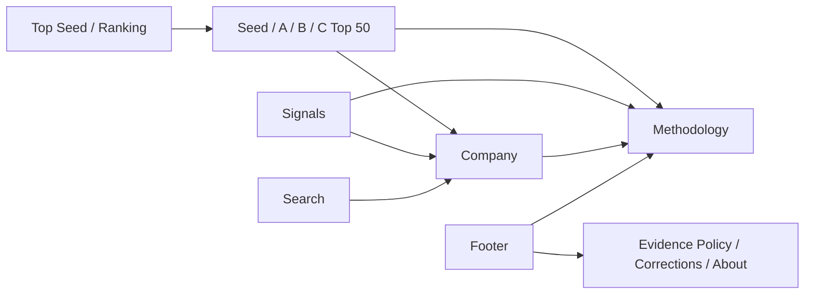
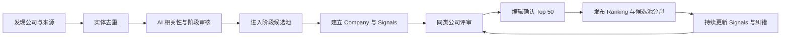

# Top Seed｜官网产品 PRD

> 文档状态：产品评审稿  
> 产品范围：Top Seed 公开网站  
> 权威关系：本文是 Top Seed 当前方向的主 PRD；`Momentum-Arena-官网与商业化-PRD.md` 保留为历史讨论，不再作为实现依据。  
> 当前实现基线：截至 2026-08-22，网站已上线 Ranking、Company、Compare、Search 和政策抽屉，包含 30 家 Seed、30 家 Series A；Series B/C/D+ 尚未开放。

## 一句话需求

Top Seed 从全球符合条件的 AI 公司中，按 Seed、Series A、Series B、Series C 各选出 50 家最值得持续关注的公司，用公开来源解释入选与排序依据，并持续整理真正影响判断的公司信号。

## 1. 为什么做

### 1.1 用户问题

VC、家族办公室、企业战略与创新团队、咨询与行业研究团队需要持续回答三类问题：

1. 当前每个早期融资阶段，哪些 AI 公司最值得优先关注；
2. 一家公司为什么值得关注，判断依据是否可以核查；
3. 公司近期发生了哪些真正重要的变化，这些变化是否改变了原有判断。

Dealroom、Crunchbase 等数据库提供大规模公司与融资资料，但用户仍需自行筛选、补充公司动态并形成判断。Top Seed 的价值来自可信筛选、清楚解释和持续更新，不以收录数量作为首页卖点。

### 1.2 数量决策

公开市场的候选范围远大于 200 家。[Stanford AI Index](https://hai.stanford.edu/ai-index/2026-ai-index-report/economy) 统计，2025 年全球有 3,499 家 AI 公司新获融资；[Dealroom](https://dealroom.co/sectors/ai/) 的 2026 年广义 AI 活动页显示 34,500 家相关公司；[CB Insights](https://www.cbinsights.com/research/report/artificial-intelligence-top-startups-2025/) 的 2025 AI 100 从 17,000+ 家候选公司中选出 100 家。完整测算见 [Top Seed company-count sizing](../work/topseed-market-sizing/topseed_company_count.ipynb)。

本轮确定：

- 每个融资阶段公开 Top 50，共 200 家；
- Top 50 是公开产品的主体，不公开展示完整候选公司列表；
- 每个阶段说明 Top 50 从多少家符合条件的候选公司中选出；
- 候选池数量必须来自实际完成的筛选与去重，不能使用数据库总量代替；
- Top 50 以外的公司继续进入内部研究池，为后续排名更新提供基础。

### 1.3 产品目标

- 用户进入 Ranking 后能快速获得一个有记忆点的阶段性 AI 公司名单；
- 用户可以从排名或 Signals 进入 Company，理解公司、核心证据和信息缺口；
- 用户可以打开原始来源，判断 Top Seed 的结论是否可信；
- 用户知道每个 Top 50 的候选池规模、准入规则、更新时间和方法版本；
- Ranking 保持稳定、可解释，Signals 负责承接公司发展过程中不规律但重要的变化。

## 2. 本轮产品边界

### 2.1 改前与改后

| 模块 | 当前实现 | 本轮目标 |
|---|---|---|
| 品牌 | Top Seed | 保持 Top Seed；品牌标志返回 Ranking 首页，不作为导航栏目 |
| Ranking | Seed 30、Series A 30；B/C/D+ 显示 Coming soon | Seed、A、B、C 各 Top 50；不展示 D 轮入口 |
| 公司范围 | 页面文案与分类以 AI software 为主 | 覆盖 AI 软件、硬件、芯片、算力、机器人、自动驾驶、AI 科学及软硬一体公司 |
| 候选池 | 只显示已收录数量，未说明筛选分母 | 每个阶段显示从多少家符合条件的公司中选出 Top 50，并标记统计日期 |
| Explore | 搜索与分类筛选位于 Ranking | 保持在 Ranking 内，不新增 Explore 一级导航 |
| Company | 从 Ranking、Search、Compare 进入 | 从 Ranking、Signals、Search 进入；不设一级导航 |
| Compare | 一级导航和独立页面 | 删除公开入口与页面 |
| Signals | 排名页只显示少量 Latest updates | 新增一级导航和独立页面，发布经过筛选的重要公司信号 |
| Subscribe | 顶部、移动导航与页脚均有入口，但没有真实权益 | 全部删除；商业模式和用户权益确定后再设计付费或订阅入口 |
| Methodology | 抽屉中提供简版方法 | 提供可直接访问、可分享的完整方法与信任说明 |
| 视觉 | 暖白编辑型数据页面和 evidence stamp | 重新设计视觉系统；当前配色、排版比例、卡片与 stamp 不作为最终基线 |

### 2.2 本轮公开范围

本轮包含：

- Ranking：首页及 Seed、Series A、Series B、Series C 四个阶段的 Top 50；
- Signals：公开信号流；
- Company：200 家入选公司的详情页；
- Search：搜索全部入选公司；
- Methodology、Evidence Policy、Corrections、About；
- 桌面、平板和移动端完整访问；
- 英文首发，产品结构需支持后续中文版本。

本轮不包含：

- Series D 及以后轮次；
- 公开候选池公司目录；
- Compare、Pick、投票或用户排行榜；
- 登录、账户、关注列表、邮件订阅、付费墙和支付；
- 用户评论、私信、社区或公司自助编辑后台；
- 私有财务、未经授权的数据和投资建议；
- 公开 API、批量导出和团队协作空间。

## 3. 产品结构

### 3.1 顶部导航

桌面端顶部只保留：

1. `Top Seed` 品牌标志：返回当前默认 Ranking 首页；
2. `Ranking`：首页和四个阶段的 Top 50；
3. `Signals`：经过筛选的重要公司变化；
4. `Search`：搜索全部入选公司。

移动端保持相同信息架构。Company、Methodology 和政策页面不占用一级导航。
所有用户可见名称和 URL 使用 `Top Seed`、`Ranking`、`Signals` 与 `Company`，不再使用 `Arena`。

### 3.2 页面关系

### 3.3 用户主流程

1. 用户进入 Ranking，看到当前默认阶段、候选池规模、Top 50 和更新时间；
2. 用户切换阶段，或使用类型、行业、地区筛选缩小阅读范围；
3. 用户打开某家公司，查看公司概览、入选依据、研究信息、Signals 和原始来源；
4. 用户进入 Signals，浏览新的产品、客户、团队、融资、技术或硬件进展；
5. 用户打开来源或 Methodology，核查证据与筛选规则；
6. 用户通过可分享 URL 返回同一阶段、公司、信号或方法页面。

## 4. 目标用户与核心场景

| 用户 | 主要任务 | Top Seed 提供的结果 |
|---|---|---|
| VC 与家族办公室投资团队 | 建立项目池、确定研究优先级、发现遗漏公司 | 分阶段 Top 50、入选依据、候选池规模、公司证据与最新信号 |
| 企业战略、创新与 CVC 团队 | 发现合作、投资、竞争和并购候选 | 行业与公司筛选、产品和商业信号、公司详情与来源 |
| 咨询、研究与行业团队 | 建立市场地图、跟踪公司变化、形成客户判断 | 稳定榜单、分类视图、信号时间线和可引用来源 |
| AI 创业者与运营者 | 理解所在类别的领先公司和市场变化 | 同阶段名单、公司定位、产品与市场证据 |
| 持续关注 AI 的专业读者 | 快速知道哪些公司值得认识 | 有记忆点的 Top 50 和高价值 Signals |

## 5. Ranking

Ranking 回答一个问题：在当前融资阶段，哪些 AI 公司最值得持续关注。

### 5.1 阶段与数量

| 阶段 | 公开数量 | 归类规则 |
|---|---:|---|
| Seed | 50 | 包含 Pre-seed；公司尚未完成可确认的 Series A |
| Series A | 50 | 最新可确认的机构股权融资为 Series A |
| Series B | 50 | 最新可确认的机构股权融资为 Series B |
| Series C | 50 | 最新可确认的机构股权融资为 Series C |

一家公司同时只能属于一个当前阶段。轮次无法确认的公司可以保留在内部研究池，但在确认前不进入 Top 50。

### 5.2 候选池

候选池是当期完成资格审核、可以参与该阶段 Top 50 评选的公司集合。公开页面不展示完整名单，只展示数量。

候选池准入条件：

1. 公司仍在独立运营，未完成 IPO、整体出售或公开停止运营；
2. AI 是核心产品、核心技术或产品价值成立的关键部分；
3. 公司属于 Seed、Series A、Series B 或 Series C 中的一个可确认阶段；
4. 可以确认公司主体、主要产品和至少一个可靠公开来源；
5. 公司不因软件、硬件或软硬一体形态被排除；
6. 同一公司、曾用名和关联品牌完成实体去重；
7. 公司信息在本期候选池截止日期前完成审核。

以下对象不进入候选池：

- 仅将 AI 作为营销描述、核心产品不依赖 AI 的公司；
- 已上市公司、被完整收购的公司和已停止运营的公司；
- 无法确认独立公司主体或当前融资阶段的项目；
- 纯研究项目、开源项目或大公司内部产品，除非已有独立公司和融资主体；
- 缺少最低公开证据、无法进行基本核查的匿名项目。

### 5.3 候选池公开表达

每个阶段标题附近使用同一信息结构：

> **Seed Top 50**  
> Selected from `<eligible_company_count>` eligible Seed-stage AI companies worldwide.  
> Reviewed through `<date>` · Methodology

其中：

- `<eligible_company_count>` 使用本期去重后的实际候选池数量；
- 数量与 Top 50 使用同一资格规则和同一截止日期；
- 未完成候选池审核时不展示预估数字，改为 `Candidate pool under review`；
- 候选池数量变化时保留旧榜单对应的历史分母，不回写旧版本；
- 全站总说明可以展示四个阶段候选池之和，但阶段页仍显示各自分母。

### 5.4 公司覆盖分类

Ranking 使用两组可以同时筛选的标签，避免把公司形态和市场类别混为一类。

**产品形态：**

- Software
- Hardware
- Software + Hardware

**市场类别：**

- Foundation Models & Research
- Data, Infrastructure & Developer Tools
- Compute, Chips & Data Centers
- Robotics, Autonomy & Defense
- Horizontal Applications
- Vertical Applications
- AI Science, Biotech & Healthcare

分类用于理解和筛选，不在筛选结果内重新计算名次。公司可以拥有一个主要类别和多个辅助标签；列表始终保留其阶段原始名次。

### 5.5 排名判断

排名是编辑研究团队基于公开证据形成的综合判断。它衡量公司在当前阶段的相对关注价值，不预测投资回报，也不等同于公司质量、估值或短期新闻热度。

所有公司使用共同判断框架：

| 判断维度 | 需要回答的问题 | 可使用的证据 |
|---|---|---|
| 市场重要性 | 公司解决的问题是否重要，所在方向是否正在形成真实需求 | 客户问题、市场采用、采购与产业变化 |
| 技术与产品 | 产品是否成立，技术是否具有可辨认的差异 | 产品、文档、演示、基准、论文、专利、开源和技术发布 |
| 执行与采用 | 公司是否把能力转化为部署、使用或收入证据 | 客户、合作、使用量、收入、续约、设计采用和生产部署 |
| 团队与资源 | 团队是否具备完成当前任务的能力 | 创始团队、关键人才、招聘、投资人和战略资源 |
| 发展进展 | 公司是否出现足以改变原有判断的新进展 | 融资、产品、客户、团队、技术、制造、监管和部署信号 |

不同公司形态使用对应证据解释同一判断维度：

- 软件公司重点查看实际使用、客户、留存、收入、产品能力与开发者采用；
- 芯片与算力公司重点查看性能、能效、流片、量产、可用性、设计采用和基础设施部署；
- 机器人与自主系统公司重点查看真实环境能力、可靠性、制造、交付、部署、认证和客户试点；
- AI 科学、医疗与生物公司重点查看研究验证、数据、监管阶段、临床或产业合作及可重复结果；
- 软硬一体公司同时展示软件能力、硬件成熟度、制造与部署证据。

最终权重、同类公司归一化方法和编辑复核机制列入待确认。在规则完成前，榜单保持 `Editorial beta` 标识，不显示伪精确分数。

每个阶段每期固定收录 50 家公司，并使用 `#1` 至 `#50` 的唯一名次。评价结果接近时由编辑复核最终顺序，不因并列名次扩充公开名单。

### 5.6 信号与排名的关系

- 公司没有在 30 天内发布新消息，不构成降级或移出候选池的理由；
- Seed 与 Series A 公司允许较长的产品建设周期，Ranking 不设置“最近 30 天必须有非融资信号”的门槛；
- 信号数量不直接代表公司质量，重复 PR、转载和同一事实的多次发布合并为一条证据；
- 新信号只有在改变某个判断维度时才影响排名；
- 历史证据可以继续支持当前判断，并显示发生时间与最后复核时间；
- 纯宣传、无法核查的增长描述和 Estimated 信息可以作为背景显示，但不能单独支持入选或名次变化。

### 5.7 Ranking 页面内容

页面按以下顺序组织：

1. 品牌与当前阶段标题；
2. Top 50、候选池分母、审核日期和 Methodology；
3. Seed / Series A / Series B / Series C 阶段切换；
4. 当期最值得优先阅读的公司区域；
5. Top 50 完整列表；
6. 类型、类别和地区筛选及当前页面搜索；
7. 方法、独立性和纠错入口；
8. 页脚。

用户首次进入时默认展示 Seed；从阶段链接或分享链接进入时，恢复链接中指定的阶段与筛选状态。

每个排名条目至少包含：

- 名次；
- 公司名称与标志；
- 一句话说明公司做什么；
- 产品形态和主要类别；
- 总部或主要运营地区；
- 当前阶段与最近一轮可确认融资；
- 一条最能解释当前入选或位置的证据；
- Company 入口和原始来源入口。

### 5.8 排名状态

| 状态 | 产品行为 |
|---|---|
| 正常发布 | 展示完整 Top 50、候选池数量、截止日期和方法版本 |
| 当期仍在审核 | 继续展示上一期有效榜单；显示本期审核中，不发布未完成的候选池数字 |
| 公司完成新轮次 | 新轮次确认后进入对应阶段的下一次排名评审；Company 立即更新融资事实 |
| 公司被收购、上市或停止运营 | 从下一次活跃榜单移除，Company 进入 Archive 并保留历史入选记录 |
| 公司阶段存在冲突 | 显示冲突来源，暂停进入新榜单，保留最近有效历史状态 |
| 来源失效 | 保留来源记录并标记不可访问；重新寻找替代来源，不静默删除原判断依据 |
| 首期没有历史名次 | 不显示涨跌或伪造趋势，直接展示当前名次 |

## 6. Signals

Signals 回答一个问题：哪些新信息值得改变对公司或行业的理解。

### 6.1 内容范围

Signals 不等同于融资新闻流。允许收录：

- 融资、投资、收购意向和重要资本变化；
- 产品发布、能力更新、公开演示、技术文档和重要版本；
- 客户、合同、合作、收入、使用量、部署和商业化进展；
- 创始人或关键管理者对产品、市场、战略和组织的公开说明；
- 关键人员加入、离开、组织调整和具有判断价值的招聘变化；
- GitHub、Hugging Face、SDK、API、论文、专利和开发者生态变化；
- 芯片流片、量产、性能、供应链、数据中心和算力部署；
- 机器人、自动驾驶、无人系统的测试、生产、认证、交付和真实环境部署；
- 医疗、生命科学、国防等行业的监管、临床、采购和政府合同进展；
- 经确认会影响公司判断的负面事件、延迟、撤回和重大纠错。

首版公开 Signals 只覆盖 Top 200 入选公司。候选池公司的信息继续用于内部研究和下期榜单评审，不在首版 Signals 中公开。

### 6.2 来源层级

| 来源 | 使用方式 |
|---|---|
| 公司官网、博客、文档、更新日志 | 作为公司直接发布的事实来源，保留利益关系标识 |
| 创始人和管理者公开账号、演讲、播客与访谈 | 归因到具体发言人，区分事实、计划和观点 |
| 客户、合作方、监管机构、政府采购和专利记录 | 用于确认部署、合同、合作、审批与技术事实 |
| GitHub、Hugging Face、论文和技术仓库 | 用于确认发布、采用和开发者活动，不用单一表面指标代替实际采用 |
| 投资机构公告 | 用于确认融资与投资关系，标注投资方利益关系 |
| 可信媒体 | 用于独立报道和交叉确认，保留媒体名称与发布日期 |
| PR wire 与转载稿 | 作为公司提供的信息，不能自动视为独立确认 |

### 6.3 证据状态

| 状态 | 含义 | 是否可以支持排名 |
|---|---|---|
| Direct | 平台可以从原始材料直接确认具体事实 | 可以 |
| Corroborated | 同一事实得到两个或以上独立来源确认 | 可以 |
| Reported | 可信来源报道，但平台无法直接观察底层事实 | 可以，需降低确定性并明确标识 |
| Unverified / Estimated | 只有未经核实的单一说法、推测或估算 | 不可以 |

利益关系与证据状态分开显示。公司、创始人、投资人和商业合作方可以提供可靠事实，但用户需要知道来源与被评公司的关系。

### 6.4 Signal 条目

每条公开 Signal 包含：

- 公司；
- 信号类型；
- 标题与一句话摘要；
- 事件发生日期；
- 来源发布日期；
- 原始来源与来源类型；
- 证据状态和利益关系；
- `Why it matters`：该信息改变了什么判断；
- 对应市场类别与融资阶段；
- 最后复核时间；
- 纠错入口。

用户可以按阶段、产品形态、市场类别、信号类型和日期筛选。排序以事件发生日期为主；发生日期无法确认时使用发布日期并明确标识。

### 6.5 去重与更新

- 同一底层事实只生成一个 Signal；后续报道作为补充来源；
- 同一产品发布拆成多篇 PR 时合并处理；
- 后续出现新的金额、客户、性能或监管结果时更新原 Signal，并保留变更记录；
- 公司撤回内容或来源失效时保留历史状态与说明；
- 重大纠错需要同步影响 Company、Signals 和下一次 Ranking 评审。

## 7. Company

Company 是某家入选公司的完整研究入口，不出现在一级导航。页面必须让用户先理解公司，再查看排名与信号。

### 7.1 页面结构

1. 公司名称、标志、一句话说明、官网和社交链接；
2. 当前阶段、Top 50 名次、当期入选状态和最后复核时间；
3. 公司定位：解决的问题、核心产品、目标用户和商业模式；
4. 产品形态、主要市场类别和辅助标签；
5. 创始人与关键团队；
6. 融资历史、主要投资人及来源；
7. 技术、产品和知识产权信息；
8. 客户、使用、收入、合作或部署证据；
9. 适用于硬件公司的制造、供应链、认证、交付和部署信息；
10. Signals 时间线；
11. `Why selected`：进入 Top 50 的主要依据；
12. `Evidence gaps`：当前没有公开观察到、但会影响判断的重要信息；
13. 所有原始来源、证据状态、变更记录和纠错入口。

### 7.2 信息表达

- 事实、公司自述和 Top Seed 判断分开呈现；
- 每个会影响用户判断的事实显示来源和日期；
- 缺失信息统一显示 `Not publicly observed`，不根据相邻信息推断；
- 对收入、用户、性能和估值等口径保留原单位、时间范围和公司限定条件；
- Company 显示当前榜单状态，并保留曾经入选和阶段迁移记录；
- 分享链接还原到同一家公司；引用具体 Signal 时还原到对应时间线节点。

### 7.3 最低完整度

公司进入公开 Top 50 前必须具备：

- 可确认的公司主体、名称、官网和标志来源；
- 一句话产品说明、产品形态、主要类别和当前阶段；
- 创始人或核心团队信息；
- 最新融资事实及来源；
- 至少一项产品或技术证据；
- 至少一项说明当前判断的有效证据；
- `Why selected`；
- 所有公开事实的最后复核时间和纠错入口。

信息缺失可以公开标明，但不能用无来源内容补齐页面。

## 8. Search 与 Ranking 内筛选

### 8.1 全局 Search

Search 覆盖公开 Top 200 公司，支持公司名称、曾用名、产品、类别、创始人和常用关键词。结果显示公司、阶段、名次、一句话说明和主要类别，点击进入 Company。

候选池公司不出现在首版公开搜索中。

### 8.2 Ranking 内筛选

支持：

- 产品形态；
- 市场类别；
- 地区；
- 当前阶段内的关键词。

筛选只改变可见结果，不改变原始 Top 50 名次。筛选后显示 `X of 50 companies`，并提供清除筛选入口。

## 9. Methodology、信任与独立性

### 9.1 Methodology 页面

Methodology 使用可直接访问和分享的 URL，至少公开：

- Top Seed 评选的问题与指标边界；
- 候选池准入、排除、去重和阶段归类规则；
- 软件、硬件与软硬一体公司的共同判断维度及差异证据；
- 证据来源、状态和利益关系表达；
- 信号与排名的关系；
- 排名发布时间、方法版本和历史变更；
- 候选池数量的计算方式；
- 纠错、申诉和公司补充材料的流程；
- 商业合作不得影响入选、名次、证据状态和纠错顺序。

公开方法需要足以解释判断，但不必公开可以被机械复现或操纵的全部内部权重。

### 9.2 纠错

用户、公司和来源方可以提交：

- 公司主体、阶段、金额、日期和人员纠错；
- 新的原始来源；
- 对 Signal 摘要或 `Why it matters` 的异议；
- 对候选资格或入选状态的申诉。

公开记录显示当前结论、变更日期和受影响内容。纠错不能因商业合作或付费状态获得更高优先级。

### 9.3 商业独立性

- 公司不能购买入选资格或名次；
- 赞助不能改变 Ranking、Signals 的自然顺序、证据状态和纠错结果；
- Sponsored 内容必须在视觉和文案上明确标识，并位于自然排名区域之外；
- 公司可以提供补充材料和回应，材料按同一证据政策审核；
- Top Seed 不把公开榜单描述为投资建议。

## 10. 设计与动效要求

### 10.1 设计目标

新设计需要同时表达三个特点：

1. **精选感**：Top 50 是经过判断的有限名单，页面重点明确，避免把 200 家公司处理成无差别目录；
2. **研究可信度**：候选池、来源、日期、方法和信息缺口容易找到；
3. **品牌记忆**：Top Seed 拥有可以被用户记住的字体、比例、色彩、图形和动效语言。

当前暖白配色、Instrument Serif / Sans、卡片比例、evidence stamp 和现有页面动效只作为历史实现，不限制新方案。视觉设计需要在确定方向后建立完整 token、组件和动效规范。

### 10.2 页面层级

- 第一屏同时出现 Top Seed、当前阶段、Top 50、候选池分母和真实公司；
- Ranking 以有限名单和编辑层级组织内容，避免连续堆叠同尺寸卡片；
- Company 先建立公司理解，再进入证据和研究细节；
- Signals 强调时间、事件类型、公司和 `Why it matters`；
- Methodology 与来源具备正式页面层级，不隐藏在难以发现的弹窗里；
- 数据密度通过字号、留白、分组和渐进展开管理，不依赖大量边框与容器。

### 10.3 动效

动效只用于解释状态与关系：

- 阶段切换帮助用户确认当前查看的 Top 50；
- Ranking 条目展开与 Company 过渡保持公司上下文；
- Signal 展开显示证据与 `Why it matters`；
- 有真实历史榜单后，名次变化可以使用克制的位移动效；
- 没有历史数据时不模拟增长、实时更新或名次变化；
- `prefers-reduced-motion` 下保留完整信息和操作结果。

### 10.4 质量要求

- 1440px、768px、390px 三个宽度拥有经过设计的版式，不只做机械缩放；
- 排版比例、行长、信息密度和首屏节奏需要单独评审；
- 所有交互具备 hover、focus、pressed、disabled、empty 和 error 状态；
- 键盘可以完成导航、搜索、筛选、打开来源和关闭浮层；
- 状态不能只依赖颜色表达；
- 重要文本和交互满足 WCAG AA 对比度与触控尺寸；
- 页面首屏不得依赖动效完成后才出现主要内容；
- 公司标志、图片和引用材料保留来源及合理使用边界。

## 11. 数据与编辑流程

### 11.1 发布门槛

一个阶段只有同时满足以下条件才可以公开 Top 50：

- 候选池完成去重、阶段与准入审核；
- 候选池分母可以追溯到本期审核记录；
- 50 家入选公司达到 Company 最低完整度；
- 每家公司有明确 `Why selected` 和来源；
- 同类公司已经使用对应证据完成复核；
- 页面显示方法版本、榜单截止日期和候选池截止日期；
- 商业合作公司与非合作公司使用同一入选和排序流程。

### 11.2 Ranking 与 Signals 的更新关系

Signals 在证据审核完成后持续更新；Ranking 按固定版本发布。新 Signal 可以立即更新 Company 和 Signals，但只有在下一次 Ranking 版本发布时改变公开名次。重大事实纠错可以触发榜单更正，并显示原因和版本变化。

Ranking 的正式发布频率、候选池截止日和临时更正规则列入待确认。

## 12. 商业化方向与本轮边界

### 12.1 最大用户价值

Top Seed 为用户节省的是筛选和形成判断的时间。用户获得有限名单、选择依据、公司研究、重要变化和可核查来源；Top Seed 的商业价值来自这套研究能力可以持续用于投资、战略、创新和行业判断。

### 12.2 可验证的商业方向

| 方向 | 潜在付费方 | 可提供的增量价值 | 当前状态 |
|---|---|---|---|
| B2B Research | VC、家族办公室、CVC、企业战略、咨询与研究团队 | 更深公司信息、完整时间线、监控、团队列表、导出、内部备注和定期研究 | 商业假设，尚未定义权益与价格 |
| B2C Pro | 独立投资人、分析师、创业者和专业读者 | 个人 Watchlist、定向 Signals、深度资料和历史版本 | 商业假设，尚未定义权益与价格 |
| Sponsorship | 云、芯片、开发者工具、招聘、专业服务和行业品牌 | 明确标识的 Signals 栏目、类别报告、研究发布和活动合作 | 可以先验证，但不得进入自然排名 |

### 12.3 本轮产品处理

- 不展示 Subscribe、Upgrade、Pricing 或付费权益；
- 不开发登录、支付、权限、付费墙和订阅邮件；
- 可以在内部进行客户访谈、人工研究交付和 sponsorship 销售验证；
- 商业模式确定后，需要单独定义免费内容、付费内容、权益、价格、账户与转化链路；
- 无论采用何种模式，Top 50、候选池数量、基础入选依据、来源和纠错入口保持公开。

## 13. 产品观察指标

本轮先验证用户是否认可 Top Seed 的精选与判断价值。核心观察：

- 目标用户是否从 Ranking 打开 Company；
- 用户是否查看 Signals 并继续打开公司或原始来源；
- 用户是否主动打开 Methodology 或候选池说明；
- 用户是否分享阶段榜单、公司或 Signal；
- 用户是否在后续榜单或 Signals 更新后再次访问；
- 来源打开、纠错与异议是否暴露真实数据问题；
- VC、企业战略和研究团队是否愿意基于现有公开产品讨论付费研究能力。

访问量、候选池总量和邮件意向不能单独证明产品价值。具体目标值在获得第一批真实使用基线后确定。

## 14. 完成标准

### 14.1 内容与数据

- Seed、Series A、Series B、Series C 各有 50 家真实入选公司；
- 每个阶段显示经审核的候选池数量、截止日期和 Methodology；
- 200 家 Company 均达到最低完整度，不存在无来源补齐；
- 软件、硬件和软硬一体公司使用正确的产品形态与类别；
- 所有公开 Signal 都包含来源、日期、证据状态和 `Why it matters`；
- 排名、Company、Signals 和 Search 的公司主体与阶段一致。

### 14.2 页面与链路

- 顶部包含 Top Seed 品牌标志，以及 Ranking、Signals、Search 三个导航操作；
- Compare、Subscribe、Series D+ 及其移动端和页脚入口全部移除；
- Ranking 的筛选和搜索不改变原始名次；
- Ranking、Signals 和 Search 都能进入正确 Company；
- Company、Signal、Methodology 和阶段榜单拥有可恢复状态的分享链接；
- Methodology、Evidence Policy、Corrections 和 About 可直接访问；
- 空状态、来源失效、阶段冲突、榜单审核中和公司归档状态均有明确表达。

### 14.3 设计与体验

- 新视觉系统完成品牌、字体、色彩、间距、图形、组件与动效规范；
- Ranking、Signals、Company 和信任页面使用同一设计语言；
- 390×844、768×1024、1440×900 下无横向溢出、遮挡或不可操作内容；
- 键盘、可见焦点、减少动效和屏幕阅读顺序通过验证；
- 首屏直接显示真实产品与公司，不使用占位案例或虚假实时效果；
- 用户无需理解内部数据结构即可区分事实、公司自述、Top Seed 判断和信息缺口。

## 15. 待确认

| 问题 | 对实施的影响 |
|---|---|
| 四个阶段本期实际 Eligible 候选池数量 | 决定公开的 `Selected from X` 文案；数字完成去重与审核前不能上线 |
| Ranking 的正式发布频率：月度、季度或其他固定节奏 | 决定榜单版本、名次变化、截止日和编辑工作量 |
| 排名维度的权重、同类归一化和最终编辑复核机制 | 阻塞正式名次与 Methodology 完整发布 |
| 全球统一排名是否增加地区代表性约束 | 影响候选池评审和 Top 50 组成，不能仅作为前端筛选处理 |
| 战略投资、政府资助、债务融资和未命名机构轮次如何影响阶段归类 | 影响候选池、阶段迁移和公司融资历史 |
| 新视觉方向及品牌识别方案 | 阻塞最终界面设计；当前视觉系统不作为默认答案 |
| 商业化优先验证 B2B Research、B2C Pro 或 Sponsorship | 影响下一阶段权益、账户、转化入口和销售验证，不阻塞本轮公开网站 |
