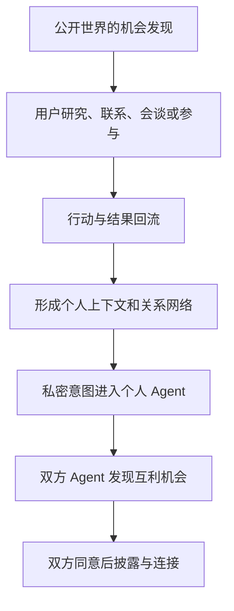

# connectto｜主动机会 Agent 产品构想

> **connectto 是一个主动帮人发现并抓住机会的 Agent。**
>
> 它理解用户正在做什么、想去哪里、能做什么，持续观察外部世界，找出此刻最值得用户认识、了解、参与或采取行动的机会。

## 一、核心判断

connectto 之前的冷启动问题是：用户需要先维护 Profile、建立 Connection、整理关系，产品才可能产生价值。这要求用户在获得回报之前先完成大量输入，也要求网络在价值成立前先存在。

主动机会 Agent 把顺序改成：

```text
用户接入必要上下文
↓
connectto 理解当前状态、目标和边界
↓
主动发现机会
↓
用户采取行动
↓
自然产生人物、项目、关系和结果数据
↓
connectto 更理解用户，后续判断更准
```

这个顺序让第一个用户就能获得价值，同时使第一阶段的单人行为自然产生后续网络所需的上下文、关系和结果。

## 二、产品从 Profile 转向 Opportunity

connectto 的核心对象是 **Opportunity（机会）**，不是 Profile、Content 或 Task。

| 对象 | 它回答的问题 | 局限 |
| --- | --- | --- |
| Profile | 我是谁 | 静态、需要维护，不直接产生行动价值 |
| Search | 我想找的东西在哪里 | 要求用户事先知道要搜什么 |
| Task | 我已经知道要做什么 | 负责记录和执行，不负责发现可能性 |
| Opportunity | 现在有什么值得我行动 | 需要同时理解用户、外部变化和行动价值 |

例如，“联系 John”是一个 Task。“John 刚发布了与你当前项目直接相关的开源项目，而且正在寻找 design partner，现在可能是认识他的好时机”才是一个 Opportunity。

Profile 仍然存在，但它变成 Agent 根据用户的连续行为自动维护的结果，不再是使用产品的入口。

## 三、connectto 如何理解用户

connectto 需要掌握的不是一份静态简历，而是用户当前的动态状态：

- 现在承担什么角色；
- 正在做什么；
- 正在解决什么问题；
- 未来一段时间想达成什么；
- 想认识哪类人，想获得或提供什么；
- 已经拥有哪些关系、资源和行动权限；
- 哪类机会曾经产生价值，哪类机会总被忽略。

上下文可以在用户授权后来自 ChatGPT 或 Claude 对话、邮件、日历、Slack 或飞书、Notion、GitHub、LinkedIn 和 X 等来源。具体接入顺序需要根据第一版验证决定。

用户提供这些上下文的直接原因是获得更好的机会，不是维护一份档案。

## 四、一个合格的 Opportunity

connectto 不交付“今日推荐 20 篇文章”式的信息流。只有能回答以下六个问题的候选项，才能成为 Opportunity：

| 字段 | 必须说清的内容 |
| --- | --- |
| What | 发生了什么 |
| Why you | 为什么与这位用户的当前状态和目标有关 |
| Why now | 为什么现在行动比以后更有价值 |
| Upside | 行动后可能获得什么 |
| Cost | 需要投入的时间、精力和承担的风险 |
| Next action | 用户现在可以采取的最小一步 |

机会不只分为 High、Medium 和 Low。Agent 内部需要判断 **Expected Opportunity Value（机会期望价值）**：

```text
潜在收益 × 个人相关性 × 时机 × 成功概率 × 新颖性
─────────────────────────────
时间 × 精力 × 风险
```

这是排序框架，不是需要展示给用户的数学公式。产品向用户展示可理解的判断和行动成本。高价值但几乎无法实现的机会，不一定优先于中等价值、高相关、高概率和低成本的机会。

## 五、机会空间

connectto 寻找一切可能帮助用户向前走的职业机会：

| 类型 | 要回答的问题 |
| --- | --- |
| People | 谁值得现在认识 |
| Projects | 什么项目值得试用、参与或贡献 |
| Knowledge | 什么内容值得现在学习 |
| Communities | 哪个社群值得进入 |
| Events | 什么活动值得参加 |
| Collaborations | 什么合作窗口正在出现 |
| Roles | 什么职业机会值得考虑 |
| Companies | 什么公司值得关注或接触 |
| Tools | 什么技术或工具值得试用 |
| Market shifts | 什么外部变化要求用户调整行动 |

长期机会空间可以很大，第一版不应同时覆盖全部类型。

## 六、第一版

### 6.1 首批用户

第一版面向处于快速变化行业的 **AI builders**：

- 创始人；
- AI 产品经理；
- FDE（Forward Deployed Engineer，负责面向客户落地解决方案的工程角色）；
- 资深工程师。

这些用户面对大量快速变化的项目、人、公司、论文、工具和工作方法，单个高价值机会也可能直接改变当前工作。

### 6.2 首版只做三类机会

1. **People**：谁值得用户现在认识；
2. **Projects**：什么项目值得用户现在试用或参与；
3. **Industry moves**：什么行业变化需要用户现在采取行动。

职位、课程、约会和通用活动发现不进入第一版。

### 6.3 首次使用

用户接入必要的工作上下文后，connectto 只需确认三件事：

1. 未来三个月想完成什么；
2. 目前愿意接受哪类机会；
3. 哪些行动未经询问绝对不能执行。

### 6.4 每日交付

每天最多交付 3 个达到高门槛的机会。用户可以继续研究、准备联系、寻找介绍路径、直接联系或忽略。

当天没有达到门槛的机会时，产品明确告诉用户“今天没有高价值机会”，不为了使用频率填充低质量内容。

### 6.5 每周交付

每周向用户提供一份 Opportunity Brief，包含：

- 本周杠杆最高的少量机会；
- 每个机会的原因、行动成本和建议下一步；
- 过去一段时间出现的行业模式；
- 这些变化可能对用户当前方向产生的影响。

每日交付解决当下行动，每周交付帮助用户保持与行业前沿一致。

## 七、从机会发现到 connectto 网络



### 第一阶段：公开机会

Agent 扫描公开网络，找出与用户当前目标相关的人、项目和行业变化。单个用户已经能获得完整价值。

### 第二阶段：个人状态与关系路径

connectto 通过用户真正联系了谁、谁回复了、哪次会谈有价值、哪类推荐总被拒绝、哪条路径最后产生合作，形成只属于这位用户的判断。

此时的机会排序已经包含私有状态和可信介绍路径，超越通用网络搜索。

### 第三阶段：双边意图匹配

当更多人使用 connectto 时，每个人的 Agent 都可以持有本人的当前意图、可提供价值和披露边界。系统可以发现双方都可以向前一步的 Mutual Opportunity（互利机会），在各方同意前不披露私密意图和身份。

这个网络的核心信息不是 Profile、Connection 和 Content，而是：

```text
Intent → Opportunity → Action → Relationship → Outcome
```

## 八、真正的飞轮

connectto 的飞轮不是单纯的用户数增长，而是每次使用都增加后续机会判断的私有信息：

```text
更多用户使用机会 Agent
↓
产生更多真实行动和结果
↓
系统更理解什么机会和关系真正有价值
↓
机会排序更准
↓
更多高质量用户愿意交给 Agent 私密意图
↓
系统发现公开互联网无法提供的机会
↓
产品价值继续提高
```

关键转换点是 **private opportunity（私密机会）**。公开搜索可以发现某个人在做什么，但不知道他私下正在考虑创业、愿意接受哪类介绍、何时愿意换工作，或某个公司正在非公开地寻找哪类人。用户可能不愿意把这些信息公开给社交网络，但愿意告诉能给自己带来直接利益的个人 Agent。

## 九、长期核心资产

connectto 长期需要形成三组相互关联的数据：

| 数据 | 包含什么 | 产生什么价值 |
| --- | --- | --- |
| Context | 用户是谁、正在做什么、了解什么、在意什么 | 判断机会的个人相关性 |
| Relationship | 用户认识谁、如何认识、信任程度、互动历史和结果 | 判断可行路径和成功概率 |
| Opportunity / Intent | 用户想要什么、能提供什么、他人想要什么、现在正在出现什么可能 | 发现双方都有价值且尚未公开的机会 |

其中 Opportunity / Intent 是 connectto 最关键的长期资产。机会 Agent 为用户提供了一个有直接回报、可以接受的理由，让他们把私密意图交给自己的 Agent。

## 十、与通用 Agent 的边界

如果 connectto 只是“个人上下文 + 网络搜索 + 排序”，通用 Agent 就能逐步覆盖它。更好的搜索和摘要能力不构成长期优势。

connectto 需要在真实使用中持续获得通用 Agent 无法从公开网络重建的状态：

1. **Private intent**：用户当前真正想要什么，但不愿公开什么；
2. **Opportunity outcomes**：过去哪类机会导致了回复、会谈、采用、合作或职业变化；
3. **Relationship paths**：通过谁能够建立可信联系，哪类介绍路径过去有效；
4. **Organization authority**：用户可以代表组织研究、试用、联系和推进到哪一步。

这四类状态使 connectto 从公开信息推荐器变成真正的职业代理系统。例如，它不只告诉用户某个项目值得了解，还能判断这个项目与当前工作的具体重合、寻找可信联系路径，并在用户的组织权限内准备下一步。

## 十一、产品承诺与公司定义

用户购买的结果是：

> **不错过那些本来可以让自己向前一步的人、项目和变化。**

一句产品承诺可以表达为：

> **Your agent watches the world for opportunities that matter to you.**

更强的情绪表达是：

> **Never miss what could move you forward.**

connectto 的长期定义也因此从“AI-native professional network”转向：

> **A network that helps people move forward.**

它关注的不是用户已经写在 Profile 里的身份，而是用户正在前往哪里，以及当下哪个行动最可能帮他向前一步。

## 十二、当前评估

| 维度 | 评估 |
| --- | ---: |
| 单用户价值 | 9/10 |
| 新行为 | 8.5/10 |
| 冷启动 | 8/10 |
| 用户维护成本 | 8.5/10 |
| AI-native 程度 | 9/10 |
| 付费潜力 | 7.5/10 |
| 网络潜力 | 8/10 |
| 通用 Agent 防御性 | 5/10 |
| 初期壁垒 | 4/10 |
| 长期想象力 | 9/10 |

当前结论：这是 connectto 目前最值得做原型验证的产品入口。它已经较好地解决了单人价值、冷启动和 Profile 维护负担，但仍未证明能够独立成为一家长期公司。

下一个必须回答的问题是：

> **为什么 connectto 最终不会只是通用 Agent 中的“每日为我找机会”功能？**

当前最有可能的答案不在更好的搜索算法，而在 **private intent、opportunity outcomes、relationship paths 和 organization authority** 这四类使用后才能形成的私有状态。

---

**来源**：2026-08-10《创业思路与方法》中关于 connectto 主动机会 Agent、单人价值、冷启动、机会网络与长期壁垒的三段讨论。
