# connectto｜第一版产品 PRD

<aside>
⚡

**connectto 帮助创业者和独立 BD 持续理解重要人物与关系，并把可信理解转化为下一次值得发生的行动。**

第一阶段交付一套可以完整、持续使用的个人关系 Agent。用户可以留下重要交流或表达当前事项；connectto 更新人物与关系理解，带回仍值得继续的关系，发现新的连接机会，组织必要表达与许可，并从真实结果中改进下一次判断。

</aside>

相关文档：[后续能力演进](后续能力演进.md) · [产品结论日志](产品结论日志.md) · [长期愿景](Agent-Native-时代的个人身份与协商基础设施.md)

# 一、第一阶段要完成什么

创业者和独立 BD 的关系工作持续发生在两个时刻：一场重要交流刚结束，需要留下人物、关系、承诺与下一步；一件当前事项已经出现，需要找到合适的人、可信路径和自然的行动方式。

第一阶段同时承接这两个时刻。用户可以从一段文字、语音、外部录音或一个当前事项开始；connectto 按需形成自我 Profile、Living Profile、关系记忆、Open Loops 和 Current Focus，并通过 Connector 帮助用户继续已有关系或发起新的 Connection。

**Connection** 记录谁与谁因为什么值得认识、相关各方是否同意，以及交流是否真正开始。每次输入、选择、许可、行动和结果继续更新人物与关系理解，使用户下一次记录、检索、复联或连接时能够直接使用已有上下文。

| 真实情境 | 用户怎样开始 | connectto 交付什么 |
| --- | --- | --- |
| 处理重要交流 | 输入文字、会后口述或导入外部录音 | 识别主要人物、最值得记住的内容、承诺、Open Loops、人物线索和 Profile 更新 |
| 继续已有关系 | 查看人物、表达当前事项，或采纳 Connector 的复联建议 | 恢复相关上下文，解释为什么值得现在继续，并准备自然下一步 |
| 场景化自我介绍 | “我想把自己介绍给 David，讨论这一轮融资。” | 只选择与 David 和本次融资相关的身份、依据与连接理由 |
| 第三方介绍 | “我想把 Nicole 介绍给 David，聊东南亚市场。” | 由介绍人署名背书、Nicole 确认、面向 David 的定向介绍 |
| 寻找下一次连接 | 用户表达当前需求，或采纳 Connector 给出的可信机会 | 解释为什么是这些人、为什么是现在，并回到同一条连接链路 |

# 二、完整产品闭环

connectto 第一版完整闭环

1. **发起连接意图**：用户通过文字或语音说明想认识谁、介绍谁以及为什么。
2. **识别角色与目的**：系统识别发起人、被介绍者、接收者和本次目的；自我介绍是“发起人等于被介绍者”的同一模型。
3. **按需理解人物**：只聚合本次涉及人物的授权资料、历史交流、用户补充和可使用的公开来源。
4. **生成定向介绍**：AI 选择与当前接收者和目的相关的事实与连接理由，用户修正会影响表达的关键信息。
5. **获得必要许可**：自我介绍由本人确认；第三方介绍先由被介绍者确认，再向接收者分享。
6. **分享 Connection Card**：接收者通过免登录私密链接理解人物、介绍人背书、双方交点和自然下一步。
7. **开始真实交流**：接收者表达愿意认识或暂不合适；双方同意后，介绍人在微信、邮件等现有工具中拉起交流。
8. **沉淀真实结果**：接受、拒绝、实际交流以及后续文字、语音和录音继续补充人物与关系理解。
9. **发现下一次机会**：用户提出新的当前需求，或 Connector 在证据充分时给出可信建议。
10. **再次连接**：用户采纳后重新进入同一条链路，让每次连接提高下一次连接的质量。

# 三、产品怎样呈现

## 3.1 首页：表达意图与发现机会

首页始终围绕“我现在想连接谁，或正在推进什么”展开。用户可以直接输入一次连接意图；上下文逐渐丰富后，首页也呈现 Connector 找到的候选机会。普通建议只出现在首页，只有明确且正在消失的机会窗口才使用推送。

## 3.2 人物页：可见、可修正的 Living Profile

**Living Profile** 是 connectto 在私人空间中对一个人的持续理解，不是首次使用前需要填写的档案。人物第一次进入 Connection 时即形成最小版本，并随真实交流、资料与结果逐渐生长。

人物页只回答五件事：

1. connectto 目前如何理解这个人；
2. 用户与这个人有哪些相关经历；
3. 当前有哪些少量、仍值得继续的关系线索；
4. 这些理解来自哪里，用户如何修正；
5. 现在可以自我介绍、介绍此人、寻找匹配或重新连接。

关系线索服务于人物理解和 Connector 判断，不形成独立任务中心。

## 3.3 Connection Card：一次连接的定向表达

Connection Card 属于一次 Connection，不是任何人的永久公开主页。默认信息顺序是：

1. 为什么值得认识；
2. 被介绍者当前是谁；
3. 为什么与接收者相关；
4. 为什么是现在；
5. 建议从什么开始；
6. 谁在介绍、哪些内容属于介绍人的判断；
7. 愿意认识或暂不合适。

# 四、信息、许可与 Agent 规则

## 4.1 信息怎样进入并更新

- 用户可以输入文字、语音或导入外部录音；语音先转成可编辑文本。
- 自我资料可以来自本人授权或主动提供的个人主页、简历、职业链接和直接表达。
- 其他人物只在一次真实连接需要时建立最小上下文，不以全量导入关系网为前提。
- 有来源的事实保留来源与更新时间；本人表达、介绍人判断、公开事实和 AI 整理始终分开。
- 每次 Connection 的选择、修改、同意、拒绝和实际结果继续写回相关人物理解，但不覆盖可追溯的旧记录。

## 4.2 分享与许可

- 第三方介绍内容由介绍人署名，AI 只负责检索、选择、压缩和组织。
- 被介绍者可以修正涉及自己的事实；本人同意前，内容不会向接收者发送。
- 每次 Connection 使用独立、不可公开检索的私密链接；接收者无需注册或登录。
- 卡片只展示本人允许、与当前连接相关且即使被转发也不会造成明显伤害的内容。
- 私人笔记、原始录音、完整转写、AI 推测和联系方式不会自动进入卡片。
- 双方同意前不披露联系方式；介绍人可以撤回分享，链接随即失效。

## 4.3 Connector 如何逐渐主动

Connector 最初响应用户明确提出的连接意图，并从用户选择了谁、为何连接、修改了什么、各方是否同意以及最终结果中学习。缺少可信上下文时不强行推荐，也不因共同标签就判断两个人应该认识。

当人物匹配、时机、双方价值和可信路径能够被解释时，Connector 可以在首页提出连接或复联建议。每条建议必须说明：

1. 为什么是这些人；
2. 为什么是现在；
3. 双方分别可能获得什么；
4. 经由谁连接、需要哪些许可。

Connector 负责发现和准备，用户始终决定是否发起、披露和发送。真实交流开始后，connectto 把表达和关系交还本人。

# 五、第一阶段怎样算成立

单次输入、Profile 更新、卡片生成或链接打开都只代表闭环中的一个步骤。第一阶段的完整价值必须连续发生：

1. 用户无需先整理完整关系库，即可形成可修正的自我 Profile，并处理一场真实交流；
2. 本次交流更新主要人物的 Living Profile、关系记忆、Open Loops 和相关人物线索；
3. 用户能够表达 Current Focus，并检索人物、继续已有关系或采纳 Connector 提出的可信机会；
4. 自我介绍、第三方介绍或复联准确说明“为什么是这些人、为什么是现在”，并获得必要许可；
5. 接收者无需注册即可理解相关性并回应，双方愿意后在已有沟通工具中开始真实交流；
6. 接受、拒绝、实际交流和后续结果回到人物理解、关系状态和 Connector 判断；
7. 用户再次记录、检索、继续关系或发起 Connection 时，connectto 能直接使用此前上下文；
8. 一次真实结果帮助用户完成下一次更有价值的连接或复联。

第一阶段以创业者和独立 BD 能否持续使用整套产品为完成标准：既要在一次输入或当前事项中产生即时价值，也要让已有理解在之后正确重新出现并改变行动。首轮先观察完整行为，获得稳定样本后再确定量化标准。

---

**讨论来源**

- [智能硬件与创业方向共享讨论](https://chatgpt.com/share/6a6cbf14-8d20-83ea-8b5f-5ecdd5acb24c)
- [产品结论日志](产品结论日志.md)

[第一阶段讨论稿｜产品形态、交互与实现](第一版产品-PRD/第一阶段讨论稿-产品形态、交互与实现.md)