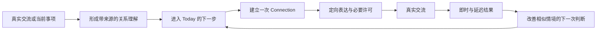

# connectto｜第一版产品 PRD v2（历史版本）

> ⚠️ **历史版本｜已于 2026-08-10 被取代**
> 当前产品方向见 [connectto｜主动机会 Agent 产品构想](connectto-主动机会-Agent-产品构想.md)。第一版先验证单用户的主动机会发现，Profile、关系工作流、Connection 与多方协商不再是冷启动前提。
> 本页保留为此前“已有关系推进”方案记录，不再作为当前第一版范围或研发依据。
相关文档：[竞品地图与完整调研报告](竞品地图与完整调研报告-旧方向.md) · [产品结论日志](产品结论日志.md) · [后续能力演进](后续能力演进.md) · [长期愿景](Agent-Native-时代的个人身份与协商基础设施.md)
# 一、第一版解决什么
## 1.1 目标用户与关系边界
第一版服务创业者和独立 BD，先处理用户已经认识、已经连接、已经发生过真实交流，或能够通过可信关系路径触达的人。
公开资料只补充人物背景，不用于批量寻找陌生人、冷启动获客或自动外联。用户无需先导入完整通讯录，也不需要持续维护一套 CRM 数据库。
## 1.2 两个入口进入同一条闭环
<table fit-page-width="true" header-row="true">
<tr>
<td>入口</td>
<td>用户当下的问题</td>
<td>connectto 的即时交付</td>
</tr>
<tr>
<td>一场重要交流刚结束</td>
<td>我该记住什么，答应了什么，接下来怎么办</td>
<td>可修正的人物与关系理解、来源、Open Loops 和下一步</td>
</tr>
<tr>
<td>一件当前事项已经出现</td>
<td>我该找谁、为什么是现在、怎样自然推进</td>
<td>候选人物或可信路径、匹配理由、必要许可和可执行下一步</td>
</tr>
</table>
两种入口最终进入同一条闭环：

## 1.3 第一版的产品合同
connectto 必须同时做到四件事：
1. **定向表达**：同一个人面对不同接收者和目的时，展示不同内容；
2. **来源清楚**：本人表达、介绍人判断、公开资料与 AI 整理不混在一起；
3. **许可明确**：谁能看、看什么、用于什么、看多久，以及拒绝、撤回和过期如何发生；
4. **结果真实**：不以发送、打开或回复代替真实交流、下一步和延迟结果。
# 二、产品的核心对象
后台可以高度结构化，但用户不需要维护字段、阶段和报表。
<table fit-page-width="true" header-row="true">
<tr>
<td>对象</td>
<td>负责什么</td>
<td>主要出现在哪里</td>
</tr>
<tr>
<td>**Person**</td>
<td>一个人的身份锚点</td>
<td>People、选择人物、Connection 参与者</td>
</tr>
<tr>
<td>**Relationship**</td>
<td>用户与这个人如何认识、如何变化</td>
<td>People 的人物详情</td>
</tr>
<tr>
<td>**Interaction**</td>
<td>一次真实交流、会面、消息或记录</td>
<td>人物时间线、Connection 故事</td>
</tr>
<tr>
<td>**Claim**</td>
<td>一条带来源、时间和适用范围的事实或判断</td>
<td>Living Profile、定向表达、来源说明</td>
</tr>
<tr>
<td>**Open Loop**</td>
<td>一件尚未完成的关系行动或等待</td>
<td>Today、人物详情、Connection</td>
</tr>
<tr>
<td>**Connection Case**</td>
<td>一次有明确目的、参与者、许可和结果的关系推进</td>
<td>Connections；用户侧简称 Connection</td>
</tr>
<tr>
<td>**Representation**</td>
<td>面向特定接收者和目的生成的一次表达</td>
<td>Connection Card、许可页</td>
</tr>
<tr>
<td>**Consent**</td>
<td>某位参与者对本次内容或行动的明确决定</td>
<td>Connection 状态、免登录 Web 页</td>
</tr>
<tr>
<td>**Outcome**</td>
<td>是否真实交流、下一步和延迟结果</td>
<td>Connection 故事、后续建议依据</td>
</tr>
</table>
## 2.1 People 与 Connections 的区别
**People 是长期上下文。** 它以“这个人以及我和他的关系”为中心，回答：他是谁、我们如何认识、最近发生了什么、哪些理解来自哪里、现在有什么值得继续。一位 Person 可以参加多次 Connection。
**Connection 是一次关系推进。** 它以“这次想促成什么”为中心，记录：参与者、目的、为什么是现在、定向表达、谁已经许可、当前等谁、真实交流和结果。一次 Connection 可以关联两位或多位 Person。
例如，Nicole 和 David 各自拥有 People 中的长期上下文；“把 Nicole 介绍给 David 讨论东南亚市场”是一条 Connection。Connection 的结果完成后，再写回 Nicole、David 及相关 Relationship。
## 2.2 Connection 何时建立
系统发现一个候选机会时，只在 Today 中显示建议，不自动创建 Connection。用户决定推进，或明确发起自我介绍、第三方介绍、复联时，才建立 Connection。
这避免把所有人物线索和 AI 猜测变成需要用户管理的状态。
# 三、用户看到的产品
## 3.1 一级信息架构
第一版主导航只有三个区域：
<table fit-page-width="true" header-row="true">
<tr>
<td>区域</td>
<td>用户来这里做什么</td>
<td>界面原则</td>
</tr>
<tr>
<td>**Today**</td>
<td>输入新交流或当前事项；安排、完成或处理少量关系下一步</td>
<td>轻量时间线，不做任务墙</td>
</tr>
<tr>
<td>**People**</td>
<td>理解人物与关系，恢复相关语境，查看可信路径</td>
<td>先给当前最重要的内容，再展开历史</td>
</tr>
<tr>
<td>**Connections**</td>
<td>查看正在发生和已经结束的关系推进</td>
<td>用关系故事呈现，不做销售 Pipeline</td>
</tr>
</table>
**Living Profile 不设独立 Tab。** 用户自己的 Living Profile、Current Focus、来源和表达边界从右上角头像进入；当用户生成介绍、修改自我表达或确认披露时，也可在当前流程中直接打开相关内容。
## 3.2 Today
Today 是首页，也是产品形成持续使用习惯的主要表面。它只承接关系行动，不扩展成通用待办工具。
- 顶部提供文字、语音和录音导入入口，用户可以记录交流或表达当前事项；
- 尚未安排的 Open Loops 进入轻量收件箱；
- 用户把少量事项安排到今天或本周，也能看到“当前等待谁”；
- 未完成事项必须被重新安排、继续等待、关闭或标记为不再行动，不形成无限积压；
- Agent 的机会建议必须解释为什么是这些人、为什么是现在、双方可能获得什么和可信路径；
- 首屏不出现联系人数量、漏斗、赢单概率、关系分数或批量操作。
## 3.3 People
People 同时提供人物列表、搜索和人物详情。关系图可以作为辅助视图验证，但不是首页，也不是第一版成立的前提。
人物详情优先回答：
1. 这个人现在最值得知道的三点；
2. 用户与他如何认识、最近发生了什么；
3. 当前有哪些 Open Loops 或正在发生的 Connections；
4. 每条重要理解来自哪里，用户如何更正；
5. 现在可以准备交流、复联、介绍此人或寻找可信路径。
## 3.4 Connections
Connections 分为正在发生和已经结束两类。详情页使用纵向故事呈现理由形成、内容修改、许可、发送、回应、真实交流和结果。
用户首先看到“这次为什么发生、现在等谁、接下来是什么”，再按需查看完整历史。内部状态机不得直接变成看板列或销售阶段。
## 3.5 外部参与者页面
被介绍者和接收者通过手机可用的免登录私密 Web 页面参与：
- 被介绍者确认面向谁、为了什么、展示哪些内容；
- 接收者理解为什么值得认识，并选择愿意认识、暂不合适或不回应；
- 页面显示发起人、内容来源、用途和有效期；
- 双方同意前不披露直接联系方式；
- 撤回或过期后，原链接立即失效。
## 3.6 表面体验
后台能力应像成熟的 to B 系统一样严谨，用户表面应像优秀的 to C 产品一样轻。
- 手机优先，一个页面只推动一个主要决定；
- 用自然语言、卡片、时间线和关系故事承接复杂结构；
- 视觉活泼、年轻、友好，保留一层商业可信度；
- 来源、许可、当前状态和下一步持续可见，但不暴露技术字段；
- 不用游戏化、红点堆积或人物评分制造关系焦虑。
# 四、轻量 Agent
第一版需要一个轻量 Agent。它是贯穿 Today、People 和 Connections 的整理与准备能力，不是独立 Tab、独立工作台或必须持续聊天的角色。
<table fit-page-width="true" header-row="true">
<tr>
<td>阶段</td>
<td>Agent 负责什么</td>
<td>用户需要决定什么</td>
</tr>
<tr>
<td>输入</td>
<td>整理文字、语音、录音和对话，识别人、事件、来源与 Open Loops</td>
<td>修正会影响人物、承诺、分享或行动的内容</td>
</tr>
<tr>
<td>理解</td>
<td>恢复相关 context，形成当前摘要，区分事实、判断和推断</td>
<td>确认关键事实和私人判断</td>
</tr>
<tr>
<td>行动</td>
<td>准备下一步、候选人物、连接理由和沟通草稿</td>
<td>是否采纳、修改、延后或关闭</td>
</tr>
<tr>
<td>Connection</td>
<td>生成接收者定向表达，指出缺失信息，跟踪当前等谁</td>
<td>对外内容、披露和发送</td>
</tr>
<tr>
<td>结果</td>
<td>在自然时机轻问是否交流、下一步和后续结果</td>
<td>哪些结果可以保存或影响后续建议</td>
</tr>
</table>
## 4.1 Agent 的边界
- Agent 可以提取、检索、总结、建议、起草和提醒；
- Agent 不能代替任何参与者同意、拒绝、披露、发送或形成承诺；
- 第一版不做自主外联、长期后台协商或为未注册参与者创建临时 Agent；
- 所有对外可见内容由确定性权限规则控制，模型不能直接改变 Consent 或 Connection 状态；
- Agent 提出的匹配和下一步必须说明依据，用户可以更正或拒绝学习。
# 五、四条关键路径
## 5.1 记录一场真实交流
1. 用户输入文字、会后口述、录音文件或 App 内录音；
2. Agent 识别主要人物、发生了什么、关键 Claim、承诺、Open Loops 和人物线索；
3. 用户只确认会影响身份、承诺、分享或下一步的内容；
4. 系统更新 People 中的长期上下文；
5. 需要行动的内容进入 Today，已安排事项保留时间和当前负责人。
## 5.2 推进一个当前事项
1. 用户用一句话说明正在推进什么；
2. Agent 根据已有 People、Relationship、Interaction 和 Outcome 找到候选人物或可信路径；
3. 每个建议解释“为什么是他、为什么是现在、双方价值和经由谁连接”；
4. 用户采纳后创建 Connection；不采纳的建议不污染人物判断；
5. 用户可以直接复联、自我介绍或发起第三方介绍。
## 5.3 完成一次第三方介绍
1. 用户选择被介绍者、接收者和本次目的；
2. Agent 聚合本次允许使用的 Claim，生成可编辑的定向表达；
3. 用户确认自己的介绍判断；
4. 被介绍者通过免登录页面修正事实并明确同意；
5. 系统为接收者生成私密 Connection Card；
6. 用户发送，接收者选择愿意认识、暂不合适或不回应；
7. 双方愿意后，用户在微信、邮件等现有工具中拉起真实交流；
8. connectto 在自然时机轻问实际交流、下一步和延迟结果。
自我介绍复用同一模型，发起人与被介绍者为同一人，因此跳过第三方本人确认。已有关系复联也复用同一模型，但可以跳过免登录卡片和联系方式交换。
## 5.4 处理今天的关系行动
1. 用户在 Today 看见已安排事项、等待事项和少量有依据的建议；
2. 每项行动都绑定具体人物、来源、为什么现在、当前等谁和下一步；
3. 用户可以完成、改期、继续等待、关闭或转成 Connection；
4. 当天未完成事项必须被明确处理，不用逾期红色制造压力；
5. 行动与结果写回 People 和相关 Connection。
# 六、状态模型
## 6.1 Connection 状态
<table fit-page-width="true" header-row="true">
<tr>
<td>状态</td>
<td>用户看到的含义</td>
<td>下一步责任人</td>
</tr>
<tr>
<td>**准备中**</td>
<td>正在确认人物、目的、来源和定向表达</td>
<td>发起人</td>
</tr>
<tr>
<td>**待本人确认**</td>
<td>被介绍者尚未确认内容与意愿</td>
<td>被介绍者</td>
</tr>
<tr>
<td>**可发送**</td>
<td>必要许可已齐，等待发起人发送</td>
<td>发起人</td>
</tr>
<tr>
<td>**等待接收者**</td>
<td>卡片已发送，等待接收者决定</td>
<td>接收者</td>
</tr>
<tr>
<td>**双方愿意**</td>
<td>可以交换联系方式并开始真实交流</td>
<td>发起人或双方</td>
</tr>
<tr>
<td>**交流中**</td>
<td>真实交流已开始，尚未回收结果</td>
<td>参与者</td>
</tr>
<tr>
<td>**待结果**</td>
<td>等待即时或延迟结果</td>
<td>发起人</td>
</tr>
<tr>
<td>**已完成**</td>
<td>已记录结果及是否存在下一步</td>
<td>无</td>
</tr>
<tr>
<td>**已拒绝／已撤回／已过期**</td>
<td>本次 Connection 不再继续</td>
<td>无</td>
</tr>
</table>
不同 Connection 类型可以跳过不适用状态，但不能绕过必要许可。每次状态变化保留操作者、时间、原因和可见范围。
拒绝者可以选择是否提供原因；发起人只看到本次不继续，不自动看到私人理由。不回应不等于同意，也不会触发重复催促。
## 6.2 Open Loop 状态
Open Loop 只表达关系行动，不评价人物价值：
- **Inbox**：已识别但尚未安排；
- **Today**：今天准备处理；
- **Scheduled**：已安排到未来；
- **Waiting**：当前等待他人或现实事件；
- **Done**：已经完成；
- **Closed**：明确不再继续。
# 七、来源、定向表达与许可
## 7.1 Claim
每条重要 Claim 至少保留：关于谁、内容、来源类型、来源位置、发生或更新时间、适用场景、可见范围和当前状态。
来源类型固定区分：
1. 本人直接表达；
2. 介绍人判断；
3. 可核实的公开资料；
4. AI 对已有材料的整理或推断。
AI 推断不能伪装成事实。用户的修正形成新版本，不覆盖旧来源和历史记录。
## 7.2 Representation 与 Connection Card
Representation 是从 Claim 中为某个接收者、某个目的选择并组织的一次表达。它必须记录接收者、目的、使用的 Claim、介绍人判断、有效期和版本。
Connection Card 不是永久公开主页，也不是完整 Living Profile 的副本。任何会改变对外含义的修改都会产生新版本，并使此前对该内容的许可失效，需要重新确认。
## 7.3 许可规则
- 第三方介绍必须先获得被介绍者明确同意；
- 发给接收者的内容只能来自本次已获许可的 Representation；
- 联系方式在双方愿意前保持隐藏；
- 链接不可公开检索，并具有系统默认有效期；用户可以提前撤回；
- 私人笔记、原始录音、完整转写、未确认推断和拒绝理由不会自动披露；
- 更正、撤回、过期和删除必须作用于真实访问权限，而不只是修改界面状态；
- 所有查看、确认、撤回和发送保留审计记录。
# 八、结果与学习
## 8.1 结果分四层记录
1. **许可结果**：同意、拒绝、撤回、不回应或过期；
2. **连接结果**：是否真正开始交流；
3. **即时结果**：交流是否有价值、是否形成明确下一步；
4. **延迟结果**：后续合作、融资、招聘、帮助或关系变化实际发生了什么。
发送、打开和回复只作为过程信号，不能替代真实结果。
## 8.2 结果怎样回收
- 真实交流后先用一个短问题确认是否发生和是否有下一步；
- 在与事项节奏相关的时间再次轻问延迟结果，不建立高压提醒队列；
- 用户可以说明结果的私密性和适用范围；
- 外部录音、文字或后续交流也可以补充结果。
## 8.3 结果怎样影响下一次判断
结果只影响相似目的、关系类型、时机和路径下的建议。系统不得生成跨情境的统一人物分、关系分或 Connector Score。
当历史结果影响一条新建议时，用户能够看到原因，选择采纳、纠正或要求系统不再使用该判断。
# 九、第一版范围
## 9.1 必须交付
- 手机可完成的文字、语音和录音输入；
- 用户自己的最小 Living Profile、People 与可修正的关系理解；
- Today 的 Inbox、Today、Scheduled、Waiting 和未完成处理；
- People 的搜索、人物详情、来源和 Open Loops；
- Connections 的完整状态、故事和结果；
- 自我介绍、第三方介绍和已有关系复联；
- 被介绍者确认页与接收者 Connection Card；
- 拒绝、撤回、过期、链接失效和联系方式延迟披露；
- 即时结果、延迟结果和相似情境学习；
- 全局轻量 Agent 与可追溯的事件记录。
## 9.2 本轮不做
- 陌生人推荐、公开关系市场、冷启动获客和自动外联；
- 团队 CRM、销售 Pipeline、漏斗、批量操作和收入归因；
- 通用任务管理、日历替代或无限待办队列；
- 永久公开 Profile、社区 Feed 或以内容增长为核心的网络；
- Agent 自主发送、披露、同意、拒绝或作出承诺；
- 为未注册参与者创建长期或临时 Agent；
- 统一人物价值分、关系健康分或公开声誉分；
- 取代微信、邮件或其他真实沟通工具；
- 把关系图作为第一版成立的必要条件。
# 十、验收与验证
## 10.1 功能验收
1. 新用户无需导入完整关系库，即可从一次真实交流或当前事项获得可修正结果；
2. 一次交流可以更新主要人物、来源、Open Loops 和 Today；
3. Today 的每项行动都能说明相关人物、来源、当前等谁和下一步；
4. 用户可以从建议或明确意图建立 Connection，也能拒绝建议而不生成多余状态；
5. 第三方介绍在被介绍者许可前不会向接收者披露内容；
6. 接收者无需注册即可理解相关性并自由回应；
7. 内容修改、撤回和过期会真实改变访问权限；
8. 双方愿意后，用户可以把交流带回现有沟通工具；
9. 系统能够回收是否交流、即时下一步和延迟结果；
10. 历史结果只影响相似情境，用户能看到并修正影响原因；
11. People 保留长期上下文，Connection 保留本次过程和结果，两者不会互相覆盖；
12. 第一版关键路径在手机上独立完成，不要求其他参与者安装 connectto。
## 10.2 第一轮验证
<table fit-page-width="true" header-row="true">
<tr>
<td>假设</td>
<td>观察什么</td>
<td>失败后的产品动作</td>
</tr>
<tr>
<td>用户愿意从真实交流或当前事项开始</td>
<td>首次价值出现前的步骤、中断点和修正量</td>
<td>缩短入口，只保留改变结果的问题</td>
</tr>
<tr>
<td>Today 能形成低压力的持续使用</td>
<td>安排、完成、改期、关闭和再次打开的真实行为</td>
<td>减少任务感，强化人物与原因</td>
</tr>
<tr>
<td>定向表达比通用 Profile 更有价值</td>
<td>被介绍者和接收者是否理解“为什么是我、为什么是现在”</td>
<td>重做信息顺序，不增加更多资料</td>
</tr>
<tr>
<td>逐次许可不会破坏完成率</td>
<td>确认耗时、放弃点和未授权披露</td>
<td>删除不影响安全的步骤，许可边界不降级</td>
</tr>
<tr>
<td>可信介绍产生真实结果</td>
<td>双方是否交流、是否形成下一步和延迟结果</td>
<td>不用发送率、打开率或文案满意度替代</td>
</tr>
<tr>
<td>结果能改善下一次建议</td>
<td>用户能否解释为什么采纳或拒绝新建议</td>
<td>保留结果记录，停止宣称学习闭环</td>
</tr>
</table>
未授权披露的验收目标为 **0**。其他量化阈值在第一轮真实样本形成后确定，不在没有基线时预设增长结论。
# 十一、实现约束与待确认项
## 11.1 实现约束
- Person、Relationship、Claim、Connection、Consent、Outcome 和状态事件使用结构化数据作为事实源；
- 向量检索和模型上下文只辅助查找与生成，不能成为权限、状态和来源的唯一记录；
- Consent、链接有效性、状态迁移和披露范围由确定性规则执行；
- AI 生成内容保留输入依据、版本和用户修改；
- 所有对外行动与关键状态变化进入不可覆盖的事件记录；
- 单体架构可以先交付，但领域边界按上述对象保持清楚，避免以后拆分时重写产品模型。
## 11.2 不阻塞原型的待确认项
- 主用户端采用原生 iOS 还是响应式 Web；无论技术选型如何，第一版关键路径必须在手机完成；
- App 内录音、外部录音和原始文件的保留时间、删除机制与地区合规；
- 私密链接默认有效期、结果回访问句与通知节奏；
- 第一轮试用规模、激活、持续使用和结果质量的量化阈值；
- 关系图是否在 People 中保留为辅助视图。
这些待确认项影响实现或实验参数，不再改变 Today／People／Connections、Connection Case、定向表达、逐次许可和结果学习的产品骨架。
---
**本版取代的旧结论**
- “首页、人物页和 Connection Card 仍只是待讨论假设”；
- 第一版采用三档授权并由 Agent 自主对外推进；
- 未注册参与者需要临时 Connector；
- Living Profile 需要独立一级入口；
- 关系图是第一版必须成立的主要表面。
历史讨论见：[第一阶段讨论稿｜产品形态、交互与实现](第一版产品-PRD/第一阶段讨论稿-产品形态、交互与实现.md)。
[第一阶段讨论稿｜产品形态、交互与实现](第一版产品-PRD/第一阶段讨论稿-产品形态、交互与实现.md)

---

来源：[Notion 原页面](https://app.notion.com/p/3af1dcd09d3d81c0aea6e9e4198f977c?pvs=204)
