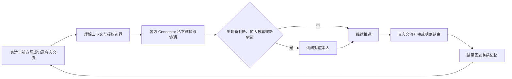

# connectto｜第一版产品 PRD

<aside>
⚡

**connectto 是创业者和独立 BD 的关系工作系统。**

第一阶段承接会前准备、真实交流、记录、协调和下一次交流。每位参与者分别表达意图、条件和披露边界；Connector 在本人授权范围内推进，并从真实结果中持续更新人物与关系理解。

</aside>

相关文档：[第一阶段讨论稿](第一版产品-PRD/第一阶段讨论稿-产品形态、交互与实现.md) · [产品结论日志](产品结论日志.md) · [后续能力演进](后续能力演进.md) · [长期愿景](Agent-Native-时代的个人身份与协商基础设施.md)

# 一、第一阶段要完成什么

第一阶段以创业者和独立 BD 已经认识、已经连接或已经发生过真实交流的人作为关系入口和信任路径。公开信息只补充这些人物的背景，不用于陌生人推荐、冷启动获客或冷启动外联。新的参与者只能通过已有关系形成的具体可信路径进入一次 Connection。

用户可以从一场真实交流或一个正在推进的事项开始。connectto 按需形成自我 Profile、Living Profile、关系记忆、Open Loops 和 Current Focus，并通过 Connector 帮助用户完成一整条关系工作链：**会前准备 → 真实交流 → 记录发生了什么 → 持续协调和推进 → 为下一次交流做准备。**

**Connection** 是围绕一次具体连接意图展开的多方协商。每位参与者分别拥有自己的意图、条件、私人判断和披露边界；真实交流开始、条件被接受或各方明确结束后，本次结果回到相关人物与关系上下文。

| 真实情境 | 用户怎样开始 | connectto 交付什么 |
| --- | --- | --- |
| 会前准备 | 打开一段已有关系或正在推进的事项 | 恢复人物、关系、承诺、条件和本次交流目标 |
| 记录真实交流 | 输入文字、会后口述或导入录音 | 更新人物理解、关系记忆、Open Loops、条件、承诺和相关人物线索 |
| 推进当前事项 | 用一句文字或语音说明最近想促成什么 | 理解可接触范围、披露边界和授权方式，并开始在已有关系中推进 |
| 多方协商 | Connector 在授权范围内联系已有关系中的相关方 | 分别收集各方意图和条件，只交换获得许可的必要信息 |
| 进入下一次交流 | 各方愿意继续，或本次 Connection 明确结束 | 准备下一次真实交流，并把接受、拒绝、交流和后续结果写回关系上下文 |

# 二、完整产品链路

# 三、产品规则

## 3.1 开始与持续使用

- 用户可以输入文字、会后口述或导入录音；语音先转成可编辑文本。
- 用户表达当前意图时，只需要说明最近想促成什么。Connector 最多追问一两个会改变行动的问题，再说明可以联系谁、可以披露什么，以及何时会回来询问本人，目标是在一分钟内开始推进。
- Current Focus、关系范围和权限对象属于系统内部结构，不做成首次使用时必须填写的配置表。
- 用户在会前恢复上下文，在会后留下新信息，在两次交流之间继续协调。人物与关系理解随每次真实结果更新。

## 3.2 授权方式

| 授权方式 | Connector 可以做什么 | 何时询问本人 |
| --- | --- | --- |
| 请求批准 | 准备行动并在每次对外行动前询问 | 每次对外行动前 |
| 在我的边界内推进 | 在已确认的意图、关系范围和披露边界内主动试探、追问和协调 | 需要新的个人判断、扩大披露范围或形成新承诺时 |
| 自主推进 | 在用户设定的长期边界内持续推进允许的关系工作 | 超出长期边界，或出现新的个人判断、披露和承诺时 |

- 新用户从“请求批准”开始。用户可以设置默认授权，也可以针对某个当前意图随时调整、降级或暂停；系统不得自行提高授权等级。
- 降级和暂停立即生效。每次行动都保留对象、原因、披露内容、对方回应和下一步记录。
- 未经允许的私人信息、法律或财务承诺、代表本人的价值判断，以及超出指定关系范围的联系，不因授权等级提高而自动放开。

## 3.3 多方私密参与

- 主用户拥有长期 Connector。
- 尚未注册的参与者通过本次 Connection 专属的临时 Connector 参与，不需要先创建账户。
- 临时 Connector 只获得完成本次协商所需的最小上下文，私下询问当事人的意图、条件和披露许可。
- 当事人之后注册时，可以在身份确认和本人同意后，把本次记录并入长期 Connector。

## 3.4 信息可见范围

- 每条事实、判断、条件和承诺都需要说明来源、可见对象、允许用途和授权状态。
- Connector 只组合所有相关参与者都允许用于本次 Connection 的最小上下文。
- 前端不要求参与者维护一份统一共享页面，只需要清楚说明某项内容谁能看见、将用于什么，以及是否已经允许对外使用。
- 本人表达、介绍人判断、公开事实和 AI 推断保持区分；私人笔记、原始录音和完整转写不会自动向其他参与者披露。

## 3.5 结果与审计

- Connector 记录联系对象、行动原因、披露内容、对方回应和下一步计划，用户可以查看、撤销授权并暂停后续行动。
- 真实交流开始、条件被接受、参与者拒绝或各方明确结束，都作为本次 Connection 的结果回流。
- 每次结果继续更新人物理解、关系状态、Open Loops 和后续 Connector 判断，但不覆盖可追溯的旧记录。

# 四、产品呈现状态

页面布局、信息架构、视觉设计和 App 的最终形态由产品同事继续定义。首页、人物页和 Connection Card 只保留为产品假设，不作为研发开工依据。

Web 与 iOS 的分工、Supabase、录音实现、原始录音保留时间和 49 美元订阅仍属于讨论稿中的技术与商业假设，本 PRD 不将它们写成最终决定。

# 五、第一阶段怎样算成立

第一阶段需要连续观察到以下结果：

1. 用户可以用一句文字或语音表达意图，并在一分钟内理解 Connector 将联系谁、披露什么和采用哪种授权方式；
2. 用户可以完成会前准备、真实交流记录、会后理解、持续协调和下一次交流准备；
3. Connector 按所选授权方式推进，并只在出现新的个人判断、扩大披露范围或形成新承诺时询问本人；
4. 未注册参与者可以通过临时 Connector 私下表达意图、条件和披露许可；
5. 任何参与者都不会看到超出本人许可和本次用途的信息；
6. 真实交流、接受、拒绝和后续结果回到人物与关系上下文，并改变下一次准备或推进；
7. 创业者和独立 BD 因关系工作持续发生在 connectto 中而再次使用产品。

# 六、开工前仍需确认

| 待确认 | 对实现的影响 |
| --- | --- |
| Connection 的完整状态、结束条件和三档授权动作矩阵 | 决定权限判断、暂停恢复、重试和审计规则 |
| 临时 Connector 的触达渠道与身份确认 | 决定未注册参与者的进入、私密回答和后续账户合并流程 |
| 文字、会后口述、录音导入和 App 内录音的完整路径 | 决定交流如何进入产品以及何时更新人物与关系 |
| 页面布局、信息架构、视觉语言和关键信任表达 | 决定客户端的页面、导航和关键交互 |
| Web 与 iOS 的职责和上线顺序 | 决定第一阶段客户端范围 |

上述问题确认前，本 PRD 不能直接作为研发排期或开工指令。

---

**讨论来源**

- [产品结论日志](产品结论日志.md)
- [第一阶段讨论稿｜产品形态、交互与实现](第一版产品-PRD/第一阶段讨论稿-产品形态、交互与实现.md)
